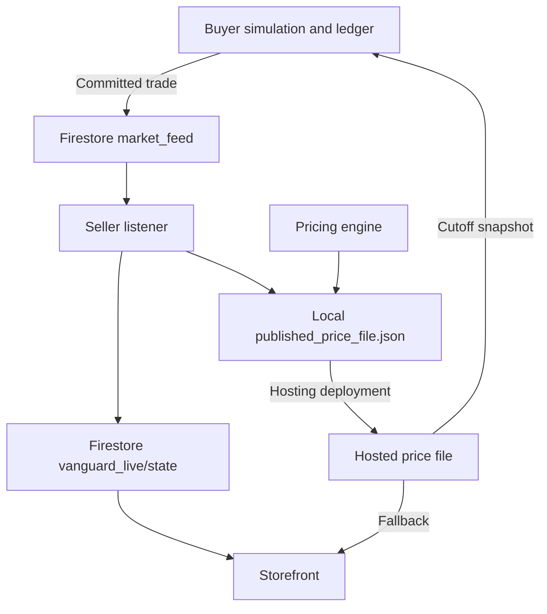

# CSC322 Toy Soldier Market

**Vanguard Garrison · Operation Warm Sole**

A course project combining a collectible toy-soldier storefront, a Python pricing engine, and a Firestore feed for simulated purchases. The storefront presents Green, Silver, and Gold soldiers, Soldier Prime returning-customer offers, and a physical-only Charity Mystery Pouch supporting the project's children's-shoes mission.

[View the storefront](https://toy-soldier-9bf43.web.app/) · [Download published offers](https://toy-soldier-9bf43.web.app/published_price_file.json)

The project keeps two markets separate:

- **Physical market:** real products, cash payments, campus pickup, and physical inventory.
- **Simulated market:** virtual customers, virtual spending, and inventory maintained by the buyer team's authoritative ledger.

The pickup form downloads a request for the customer to show the seller. It does not submit an order, reserve stock, or process payment.

**Current status:** this is a working prototype with operational gaps listed under [Known limitations](#known-limitations). Running `buyer_ping_client.py` directly attempts a demonstration write to the live market feed. Import the client and use replay mode for development.

## Features

- Whole-dollar pricing with a configured $1 minimum, $5 cap, and $0.25 assigned unit cost.
- Adaptive pricing based on competitor offers, inventory, sales velocity, and estimated customer preferences.
- Fixed-price and fixed-markup comparison catalogs.
- Soldier Prime offers with eligibility and discount terms published alongside prices.
- Separate physical and simulated availability, with zero virtual Mystery Pouch stock.
- Buyer notifications for sales, no-purchase outcomes, and round summaries.
- Firestore updates for the storefront and JSON exports for buyer snapshots.
- Pricing decision records containing inputs, recommendations, submitted prices, and overrides.

The pricing rules are strategy heuristics. They do not establish a Nash equilibrium or guarantee profit.

## How the system works



The buyer script validates offers, chooses purchases, updates budgets and stock, and records transactions before sending notifications. The seller listener consumes those notifications and refreshes its catalog.

Changing a local JSON file does **not** update Firebase Hosting. Firestore state and the hosted download have separate publication paths and must be kept consistent. Simulated purchases must use the saved daily cutoff snapshot; later recommendations must not change already accepted prices.

## Repository files

| File | Purpose |
| --- | --- |
| [`pricing_engine.py`](pricing_engine.py) | Pricing models, customer-share estimates, loyalty offers, advertising bid estimates, exports, and replay comparison catalogs. |
| [`live_market_listener.py`](live_market_listener.py) | Watches Firestore trades, updates local stock estimates, recalculates offers, and writes the live catalog. |
| [`buyer_ping_client.py`](buyer_ping_client.py) | `BuyerMarketBroadcaster`, with standard-library REST requests and optional Firestore SDK support. |
| [`public/index.html`](public/index.html) | Storefront, product cards, Standard and Prime views, feed subscriptions, and pickup-request download. |
| [`public/published_price_file.json`](public/published_price_file.json) | Offer file served by Firebase Hosting for buyer snapshots and browser fallback. |
| [`public/decision_audit_log.json`](public/decision_audit_log.json) | Pricing decision records exported into the hosted directory. |
| [`decision_audit_log.json`](decision_audit_log.json) | Separate root-level audit file; not served by the current Hosting configuration. |
| [`firebase.json`](firebase.json) | Hosting configuration serving the `public/` directory. |
| [`.firebaserc`](.firebaserc) | Default Firebase project selection. |
| [`package.json`](package.json) and [`package-lock.json`](package-lock.json) | Declared JavaScript Firebase dependency and lockfile. |

## Local setup

You need Python 3 and Git. The seller listener additionally needs `google-cloud-firestore` and authorized Firebase project credentials. Deployment requires Node.js, npm, and the Firebase CLI.

```bash
git clone https://github.com/jxvoy23/CSC322-ToySoldier.git
cd CSC322-ToySoldier
python3 -m venv venv
source venv/bin/activate
```

On Windows PowerShell, activate the environment with `./venv/Scripts/Activate.ps1`.

The pricing engine and the buyer client's REST mode use Python's standard library. Install the seller listener dependency only when needed:

```bash
python -m pip install google-cloud-firestore
```

The storefront is static HTML, CSS, and JavaScript with Firebase loaded from a CDN. There is no frontend build command. Use `npm ci` if working with the JavaScript dependencies declared in the lockfile.

### Preview the storefront

From the repository root:

```bash
python -m http.server 8000 --directory public
```

Open [http://localhost:8000](http://localhost:8000). This serves local files, but the page still reads the Firebase project configured in `public/index.html`; it does not create an isolated test database.

### Generate prices and audit records

Review the `__main__` configuration in `pricing_engine.py` first. It currently contains example inventory, competitor offers, previous sales, and round settings. Replace those inputs with approved records before generating a live catalog.

```bash
python pricing_engine.py
```

This overwrites `public/published_price_file.json` and appends a record to `public/decision_audit_log.json`. It does not deploy Hosting or update the Firestore live-state document.

The engine supports `dynamic_response`, `fixed_price`, and `fixed_markup`. Calling `generate_replay_comparison_files(...)` generates a candidate price file for each strategy. The main script does not call that function automatically. Actual outcome comparisons require the buyer replay system to recompute purchases using the same opening state and customer draws.

## Offers and inventory

These are the reference prices in the current catalog. The published offer snapshot determines the accepted price for a round.

| Offer ID | Underlying product | Reference price | Eligibility |
| --- | --- | --- | --- |
| `BASE_SKU_GREEN` | `SKU_GREEN` | $2 | Standard customers |
| `BASE_SKU_SILVER` | `SKU_SILVER` | $3 | Standard customers |
| `BASE_SKU_GOLD` | `SKU_GOLD` | $5 | Standard customers |
| `PRIME_SKU_SILVER` | `SKU_SILVER` | $2 | Eligible returning customers |
| `PRIME_SKU_GOLD` | `SKU_GOLD` | $4 | Eligible returning customers |
| `OFFER_CHARITY_MYSTERY_POUCH` | Physical mystery soldier | $3 | Physical market only |

Each offer includes `offer_id`, `product_quantities`, `total_price`, `virtual_available`, `physical_available`, `eligibility`, `loyalty_program_terms`, and a UTC `timestamp` string.

- Base and Prime offers share the same underlying SKU inventory. Do not add their availability together.
- Prime discounts are already included in `total_price`; do not subtract them again.
- Mystery Pouch `virtual_available` must remain `0`. Its catalog product mapping is not a simulated purchase option.
- Virtual purchases never deduct physical stock. Physical sales need their own records and stock updates.
- The buyer program must enforce budgets, eligibility, purchase limits, and available stock. This seller repository does not implement the full buyer simulation.

The storefront defaults to **Standard prices**. Selecting Soldier Prime changes the displayed eligible offers without creating another stock pool.

## Buyer integration

Place `buyer_ping_client.py` beside the buyer simulation and import `BuyerMarketBroadcaster`. Create one instance per process. The following example deliberately skips the network:

```python
from buyer_ping_client import BuyerMarketBroadcaster

broadcaster = BuyerMarketBroadcaster(timeout_seconds=3.0)
is_test_replay = True

sent = broadcaster.ping_trade(
    round_number=1,
    seller_id="Vanguard_Garrison",
    sku_id="SKU_SILVER",
    offer_id="PRIME_SKU_SILVER",
    price_paid=2.0,
    remaining_virtual=15,
    is_test_replay=is_test_replay,
)

print("Replay: notification skipped" if is_test_replay else sent)
```

The numbers above are illustrative, not an opening-stock configuration. For an official run, pass the actual committed transaction and explicitly set `is_test_replay=False` after addressing the launch limitations.

1. Save and validate seller offers at the announced cutoff.
2. Select an affordable, eligible offer using the approved customer model.
3. Commit the purchase, budget deduction, and SKU stock deduction in the buyer ledger.
4. Call `ping_trade` with the exact chosen offer ID, accepted snapshot price, and stock remaining **after** the purchase.
5. Record notification failures separately. A feed outage must not duplicate or reverse a valid purchase.

Use `Vanguard_Garrison` as our canonical seller ID. Preserve other sellers' agreed IDs. Set replay mode on every call made during private tests or strategy comparisons.

Additional methods are `ping_bought_nothing(...)` and `publish_round_summary(...)`; both accept `is_test_replay`. Define whether Prime sales are separate from or included in tier totals before using the summary fields for analysis.

`True` means the API accepted the write. `False` can mean an intentional replay skip or a handled failure. Some exceptions currently escape the client, so isolate notification errors from the buyer's purchase-processing loop.

If the buyer team has a separate `vanguard_market_ping.py`, its class is `VanguardMarketBroadcaster`. That file is not included in this checkout and has a different API; the example above uses the repository client.

## Firestore configuration

The configured project is `toy-soldier-9bf43`.

| Path | Writer | Use |
| --- | --- | --- |
| `market_feed/{document}` | Buyer broadcaster | Sale and no-purchase events read by the seller listener and storefront. |
| `market_summaries/{document}` | Buyer broadcaster | Round aggregates; the current seller listener does not consume them. |
| `vanguard_live/state` | Seller listener | Offer prices, virtual stock, physical stock, and last update time read by the storefront. |

REST requests without authentication are governed by deployed Firestore Security Rules. A zero-dependency client does not guarantee write access. This repository does not contain a Firestore rules configuration; `firebase.json` currently configures Hosting only.

For the seller listener, provide an authorized service-account file named `serviceAccountKey.json` in the repository root, matching the project's existing credential-loading code. Keep it outside `public/` and out of Git. Do not distribute that key to the buyer team.

After reconciling the opening state and implementing event-ordering safeguards:

```bash
python live_market_listener.py
```

Keep the process running for live synchronization and use `Ctrl+C` to stop it. Importing this listener also initializes its database connection and starts its watch; use the buyer client for buyer-side imports.

## Deploy to Firebase Hosting

Install and authenticate the Firebase CLI on the seller's machine:

```bash
npm install -g firebase-tools
firebase login
firebase deploy --only hosting --project toy-soldier-9bf43
```

Deployment publishes the contents of `public/`. It does not start the Python listener, publish Firestore rules, or synchronize the live catalog document. Verify the storefront and downloaded price file against the approved catalog after publishing.

See the official [Firebase REST API documentation](https://firebase.google.com/docs/firestore/use-rest-api) and [Hosting deployment guide](https://firebase.google.com/docs/hosting/test-preview-deploy) for access and deployment details.

## Known limitations

These are implementation gaps to address before scored rounds:

- **Live demonstrations:** direct execution of `buyer_ping_client.py` attempts a hard-coded live trade. Develop with imported clients and explicit replay flags.
- **Transport and validation:** the clients can disable TLS verification, do not catch every timeout, and coerce invalid values. Retain certificate checks and reject invalid prices, identifiers, rounds, and stock.
- **Delivery and ordering:** events lack stable transaction IDs, run IDs, and ledger sequence numbers. Add deduplication, durable pending notifications, and persisted listener checkpoints before automatic retries.
- **Listener state:** opening inventories, sample competitors, round settings, physical pouch counts, and estimated competitor prices are hard-coded. Existing feed events are not scoped to an official run and can overwrite newer stock on restart. Missing remaining stock currently defaults to zero.
- **Catalog and audit consistency:** local writes are not automatic Hosting deployments. The listener discards its returned pricing audit record, and the page does not currently load the exported audit log into its placeholders.
- **Browser feed handling:** feed values enter `innerHTML`, Refresh adds subscriptions without cleanup, and a newest-document query is not complete transaction history. Use text rendering, subscription cleanup, and event IDs. Connection labels and SDK fallback also need accurate failure handling.
- **Dependent offers and physical records:** manual base-price overrides can leave Prime discounts or the pouch anchor inconsistent. Verify physical stock, pouch allocation, draw odds, and charity progress claims against actual records.
- **Alternate project selection:** the buyer client's REST URL uses a module-level project constant. Passing another `project_id` to its constructor does not redirect REST writes; fix the URL construction before testing against a different project.

Before the first official round, reconcile virtual stock with the buyer ledger, count physical stock, verify buyer write permissions, agree on the round and cutoff, isolate demonstrations from official events, and compare the browser catalog with the buyer's saved price file. Preserve completed-round records when making corrections.
