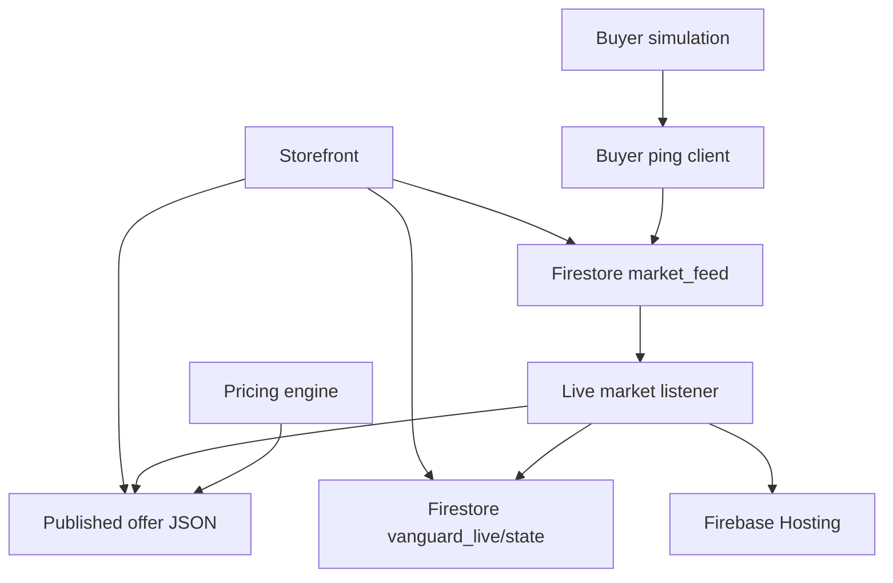

# CSC322 Toy Soldier Market

**Vanguard Garrison · Operation Warm Sole**

This repository contains the seller-side storefront and tools for a CSC322 computational game theory market. It combines a static product website, a Python pricing engine, and a Firestore listener that can refresh the published catalog when the buyer simulation reports sales.

[Open the storefront](https://toy-soldier-9bf43.web.app/) · [View the published offer file](https://toy-soldier-9bf43.web.app/published_price_file.json)

## Project overview

The market has two separate parts:

- **Physical sales:** real toy soldiers, campus pickup, physical inventory, and payment handled in person.
- **Simulated sales:** virtual customers and virtual inventory managed by the buyer team's market ledger.

This repository supports the seller side. It does not contain the buyer team's customer-choice or market-ledger program. The buyer ledger is authoritative for virtual stock; virtual purchases must not be counted as physical sales.

The storefront lets visitors view the Green, Silver, and Gold soldiers, compare Standard and Soldier Prime offers, and prepare a pickup request. The request is downloaded to the visitor's device. It is not sent to the seller, does not reserve inventory, and does not process payment.

## How the pieces connect



1. The pricing engine builds offers and a decision audit record.
2. After the buyer program commits a simulated purchase, it can use the ping client to report the sale to Firestore.
3. The live listener watches the market feed, updates seller-side virtual stock, recalculates the catalog, writes the live state, and starts a Firebase Hosting deployment.
4. The storefront reads live state and recent market activity. It can fall back to the published JSON offer file when live state is unavailable.

A local price-file change alone does not update the hosted site. The listener's deployment requires Firebase CLI access and a correctly selected Firebase project.

## Repository map

| Path | Purpose |
| --- | --- |
| `pricing_engine.py` | Builds the daily catalog, supports dynamic, fixed-price, and fixed-markup modes, estimates buyer-population beliefs, and can create comparison catalogs. |
| `live_market_listener.py` | Watches Firestore sale events, updates seller inventory state, writes the offer file, and triggers Hosting deployment. |
| `buyer_ping_client.py` | Small standard-library client that sends committed simulated sale events to the Firestore market feed. |
| `public/index.html` | Storefront, live catalog display, Standard/Prime selector, recent-trade ticker, and downloadable pickup request form. |
| `public/published_price_file.json` | Offer snapshot used by the buyer program and as the storefront fallback. |
| `public/decision_audit_log.json` | Exported pricing decision records. Because it is inside `public/`, Firebase Hosting serves it publicly. |
| `decision_audit_log.json` | Root-level audit file, separate from the hosted copy. |
| `firebase.json` and `.firebaserc` | Firebase Hosting configuration and default project selection. |
| `package.json` and `package-lock.json` | Firebase JavaScript dependency metadata; the storefront has no frontend build step. |

## Offer and inventory rules

The pricing engine uses whole-dollar offers with a configured range of **$1–$5** and an assigned wholesale cost of **$0.25 per unit**. The catalog uses one unit per offer and includes:

| Offer | Product | Availability |
| --- | --- | --- |
| `BASE_SKU_GREEN` | Green soldier | Standard customers |
| `BASE_SKU_SILVER` | Silver soldier | Standard customers |
| `BASE_SKU_GOLD` | Gold soldier | Standard customers |
| `PRIME_SKU_SILVER` | Silver soldier | Eligible returning customers |
| `PRIME_SKU_GOLD` | Gold soldier | Eligible returning customers |
| `OFFER_CHARITY_MYSTERY_POUCH` | One sealed soldier | Physical market only |

Base and Prime offers refer to the same underlying SKU inventory; they are not separate stock pools. Prime discounts are already included in the published offer price. The mystery pouch has zero virtual availability and is sold in person only.

The dynamic strategy uses inputs such as current inventory, competitor offers, recent sales, and estimated buyer types. The fixed-price and fixed-markup modes provide baselines. These are pricing heuristics for the class market; they do not guarantee sales or establish a Nash equilibrium.

## Local setup

You need Python 3 and Git. The pricing engine and buyer ping client use the Python standard library.

```bash
git clone https://github.com/jxvoy23/CSC322-ToySoldier.git
cd CSC322-ToySoldier
python3 -m venv .venv
source .venv/bin/activate
```

On Windows PowerShell, activate the environment with:

```powershell
.venv\Scripts\Activate.ps1
```

### Generate a sample catalog

```bash
python pricing_engine.py
```

The example configuration in the script uses sample inventory, competitor offers, and prior-round observations. Review and replace those values with the approved market data before using the output for an official round. Running the script writes `public/published_price_file.json` and appends to `public/decision_audit_log.json`; it does not deploy Firebase Hosting.

### Preview the storefront

From the repository root:

```bash
python -m http.server 8000 --directory public
```

Then open [http://localhost:8000](http://localhost:8000). The page still connects to the configured Firebase project, so this previews the site but does not create an isolated test market.

## Buyer-team integration

Import `BuyerMarketBroadcaster` from `buyer_ping_client.py`. Call `ping_trade` only after the buyer program has committed the purchase, deducted the buyer's budget, and updated its authoritative virtual stock. Pass the accepted offer and price snapshot, plus the remaining stock after the purchase.

Use replay mode during tests; it skips the network write:

```python
from buyer_ping_client import BuyerMarketBroadcaster

broadcaster = BuyerMarketBroadcaster(timeout_seconds=3.0)

sent = broadcaster.ping_trade(
    round_number=1,
    seller_id="Vanguard_Garrison",
    sku_id="SKU_SILVER",
    offer_id="BASE_SKU_SILVER",
    price_paid=3.0,
    remaining_virtual=15,
    is_test_replay=True,
)

print("Replay notification skipped" if not sent else "Notification sent")
```

For an official run, use the actual committed transaction values and set `is_test_replay=False`. The client sends a notification; it does not make the purchase or update the buyer ledger. Firestore Security Rules must permit the buyer client's write to the configured `market_feed` collection. A `False` result can mean the write was intentionally skipped or that it failed, so log and handle it separately from purchase processing.

Running `python buyer_ping_client.py` by itself prints a status message and does not send a sale event.

## Live listener and Firebase

The live listener requires the Firestore Python package, a service-account credential file, and Firebase CLI access:

```bash
python -m pip install google-cloud-firestore
```

Place the authorized `serviceAccountKey.json` in the repository root, keep it out of Git, and never put it under `public/`. The listener initializes Firestore and starts watching the feed as soon as the module runs. After processing a trade, it writes the live state and offer file, then starts `firebase deploy --only hosting` in the background. Run it only when you intend to connect to the live project and publish an update. Press `Ctrl+C` to stop the listener.

For a manual Hosting deployment, install and authenticate the Firebase CLI, then run:

```bash
npm install -g firebase-tools
firebase login
firebase deploy --only hosting --project toy-soldier-9bf43
```

Firebase Hosting serves the contents of `public/`. Do not put credentials or private customer information there. The audit file in that directory is public along with the storefront and offer file.

## Operational notes

- Save the buyer team's cutoff snapshot as the price basis for that round. Later catalog updates apply to later rounds.
- Keep physical inventory, simulated inventory, expenses, and sales records separate.
- Confirm current stock and prices with the seller before accepting a physical pickup request.
- Update the example state in `pricing_engine.py` and `live_market_listener.py` before relying on it for live market decisions.
- Use replay mode for strategy comparisons and make sure each comparison starts from the same buyer state and customer draws.

